# Sixth Sense — Brand Guidelines

  

**SEE BEYOND THE SCENE.**

Version 1.0 · 2026-11-17

---

## 1. Brand concept

Sixth Sense turns gameplay screenshots into intelligence. It identifies what's visible, suggests where it is, and lets a community verify what it finds.

The name describes what the product gives a player: a sense beyond sight, noticing what an ordinary look misses. The tagline, **SEE BEYOND THE SCENE.**, says the same thing as a promise. It is the only official tagline. Supporting campaign lines (e.g. "Look Closer.", "Every Screenshot Has a Story.") may be used in marketing, but never in place of it.

**Personality:** intelligent, perceptive, curious, precise. Cinematic and premium, but restrained. Mysterious without being confusing. Technical without looking corporate.

**Positioning:** a visual intelligence and discovery platform for the world of GTA VI. Not a game, a GTA clone, a chatbot or a trading platform.

---

## 2. The starburst: why it is the primary symbol

  

The starburst stands for **the moment of recognition**: when something that was there all along becomes visible. A glint in a screenshot, a detail you only notice the second time. It works as a signal, not a decoration.

It is the primary mark, ahead of the wordmark, because:

- **It does the product's job in one shape.** Eight rays spreading from one point is "something found here". The same idea appears in the analysis UI, where an identified entity is marked as a signal on the image.
- **It works without words.** It's recognisable at 16 px, as an app icon and as a social avatar, where a wordmark would be unreadable.
- **It is ownable.** A slightly taller-than-wide, eight-point glint with an open square centre is specific enough to be ours. It also avoids the clichés of the category: eyes, radar, crosshairs, brains, circuits.
- **It carries motion naturally.** Its rays can light in sequence (loading), extend from the centre (reveal) or flare once (recognition) without the symbol becoming something else.

---

## 3. Symbol construction

The symbol is one closed polygon drawn on a **48 × 48 grid** centred at (24, 24), with a small square aperture cut from the centre. Source: `src/components/brand/geometry.ts`.

| Element | Value (grid units) | Notes |
|---|---|---|
| North/south rays | 22 | The longest: a slight vertical lift, like a glint |
| East/west rays | 20 | |
| Diagonal rays | 17 | Long enough to read as eight points, short enough to keep a hierarchy |
| Notch radius | 3.6 | Notches sit at 22.5° between rays; this sets each ray's width at the root |
| Central aperture | Square, half-diagonal 1.8 | The "distinctive central intersection": the point of focus |
| Ray edges | Straight | Straight, tapered edges keep it technical. Curved (concave) edges would read as a generic sparkle icon. |

Total extent: 40 × 44 units, so there is a 2-unit margin at the top and bottom of the grid and a 4-unit margin at the sides.

### Optical sizes

Thin rays and a 1.8-unit aperture fill in when rendered very small, so there is a second drawing for small sizes:

| Variant | Use at | Changes |
|---|---|---|
| `regular` | 32 px and up | As above |
| `small` | 16–24 px | Notch radius 5 (heavier ray roots), diagonals 19, east/west 21, **no aperture** |

`<SixthSenseSymbol>` switches automatically at 24 px. The favicon uses `small`.

Tested renders: at 16 px all eight rays stay distinct (small variant); at 24 px the rays and taper are clear; at 32 px the aperture becomes visible; at 64 px and up the full construction reads.

---

## 4. Wordmark

  

**SIXTH SENSE** is set in custom geometric capitals drawn for the brand, not a typed font, so it renders identically everywhere and has no font dependency.

- Cap height 20 units, stem 3.6 units (bold, but not heavy).
- Round letters (S, O, C, D, B) are built from circular arcs with a constant stroke. Diagonals (X, N, Y) are straight bands of the same optical weight.
- Terminals are cut square, which gives it a slightly technical character.
- Tracking 4.2 units with optical kerning on tight pairs (XT, TH, …). Word space 11 units.
- The tagline uses the same capitals with wider tracking (5 units) and is set at about 0.4× the wordmark's cap height.

The wordmark is **secondary** to the symbol. Use it alongside the symbol, or alone only where the symbol already appears nearby.

---

## 5. Lockups

| Lockup | Construction | Use |
|---|---|---|
| **Horizontal** (primary) | Symbol box = 2 × cap height; gap = 0.6 × cap height; wordmark vertically centred | Navigation, headers, footers, documents |
| **Compact** | Symbol alone (`symbolOnly`) | Collapsed navigation, app rail, tight spaces |
| **Stacked** | Symbol (2.4 × cap height) above wordmark, optional tagline beneath; gaps 0.6 × cap height | Splash screens, posters, social banners |

In code: `<SixthSenseLogo />`, `<SixthSenseLogo symbolOnly />`, `<SixthSenseLogo layout="stacked" tagline />`.

### Clear space

- **Symbol alone:** keep at least **25 % of the symbol's size** clear on every side.
- **Lockups:** keep at least **one cap height** (the height of the "S" in the wordmark) clear on every side.

### Minimum sizes

| Item | Minimum |
|---|---|
| Symbol | 16 px (small variant) |
| Horizontal logo | 20 px symbol / 10 px wordmark cap height |
| Stacked logo with tagline | 48 px symbol. Below that, drop the tagline. |

---

## 6. Colour

| Token | Hex | Role |
|---|---|---|
| Midnight | `#0B1018` | Main background; "black" for one-colour marks |
| Deep Surface | `#111A25` | Primary surfaces |
| Elevated Surface | `#172331` | Cards, panels |
| **Signal Cyan** | `#55D6D0` | The starburst; key actions and selected states |
| Off White | `#F2F4F5` | Primary text; the wordmark on dark backgrounds |
| Steel Grey | `#8995A5` | Secondary text |
| Signal Orange | `#F29B52` | Warnings and attention only |
| Border | `#273443` | Dividers and boundaries |

Tokens live in `src/app/globals.css` (`@theme`) and are mirrored for generated images in `src/components/brand/colors.ts`. A test keeps the two in sync.

Cyan is the brand's signal colour. **Don't use it for everything.** Reserve it for the symbol, meaningful actions, selected states and key intelligence indicators, so that it still means something.

### Logo colour variations

| Variation | Symbol | Wordmark | Background |
|---|---|---|---|
| Primary (brand) | Signal Cyan | Off White | Midnight or other dark surfaces |
| Light (one colour) | White | White | Photography, dark colour fields |
| Dark (one colour) | Midnight | Midnight | White and light backgrounds |
| Monochrome | `currentColor` | `currentColor` | Any; the mark inherits the text colour (`tone="current"`) |

The symbol must always work in one colour. It never relies on glow, gradient or colour to be recognised.

### Backgrounds

- **Preferred:** Midnight (`#0B1018`) or Deep Surface.
- **Photography:** use the light one-colour logo, over a darkened area of the image.
- **Light backgrounds:** use the dark one-colour logo. Cyan on white has too little contrast (about 1.7 : 1) and is not allowed.

---

## 7. Incorrect use

Don't:

- Redraw, trace or approximate the symbol, or swap in an icon-library sparkle or a Unicode ✳ / ✦.
- Change the ray proportions, rotate the symbol, or add or remove rays.
- Put the symbol inside circles, rings, hexagons or badges (app icons use a plain Midnight plate only).
- Add gradients, bevels, outlines or a permanent glow to the artwork.
- Stretch, skew or condense the logo.
- Retype the wordmark in another font, or change the case.
- Put cyan on light backgrounds.
- Animate the symbol as a continuous spinner.
- Pair the logo with Rockstar or GTA logos, or anything that implies an official partnership.
- Use any line other than **SEE BEYOND THE SCENE.** as a tagline (earlier taglines are retired).

---

## 8. Typography (interface)

The interface uses **Sora** (geometric sans-serif) for text and **JetBrains Mono** for compact technical data. The wordmark's custom capitals are for the logo only.

| Role | Style |
|---|---|
| Display (hero) | Sora Bold, uppercase only for the hero tagline, tight tracking (-0.035em) |
| Page title | `text-title`, Sora Semibold |
| Section heading | `text-heading`, Sora Semibold |
| Body | `text-body` / `text-small`, Sora Regular |
| Navigation | `text-small`, Sora Regular/Medium |
| Eyebrow / technical label | `eyebrow` utility: mono, uppercase, 0.12em tracking |
| Metadata, coordinates, IDs | `meta` utility: mono, tabular numbers |

Avoid uppercase body text. Uppercase is for the hero headline, eyebrows and the logo.

---

## 9. Motion

Motion is restrained and always ends on the complete, static symbol. Components are in `src/components/brand/brand-motion.tsx`; keyframes (`ss-*`) are in `globals.css`.

| Pattern | Component | Behaviour | Use |
|---|---|---|---|
| **Reveal** | `BrandReveal` | Rays extend from the centre in clockwise sequence (60 ms apart), then one narrow band of light crosses the symbol; the wordmark fades in after | Landing hero, splash. Once per page. |
| **Loading** | `BrandLoader` | Rays brighten one after another, clockwise: a scan, not a spin | Page-level waits (route loading) |
| **Recognition** | `SignalMark` | The symbol flares once (scale + brief brightness), then rests | When analysis identifies something |
| **Interaction** | CSS transitions | 150–250 ms ease-out on hover, focus and active states | Everywhere |

Rules:

- `prefers-reduced-motion` turns every brand animation into its final, static state. The loader shows the full symbol.
- No flashing, no continuous pulsing, no continuous rotation, no aggressive parallax.
- The glow in `SignalMark` is part of the animation only. The artwork never carries a glow.

---

## 10. Using the starburst in the interface

Use the starburst where it means **recognition** or **brand**:

- Brand moments: navigation logo, hero, final call to action, footer, 404 page.
- Recognition: the signal next to "Detected" when an analysis completes with results.
- Loading: route-level loading screens.

Don't scatter it as decoration, use it as a bullet point, or use it in place of the verification badges. Those keep their own icons and text.

---

## 11. Assets

All files are generated from `geometry.ts` by `pnpm brand:assets`. Don't edit them by hand.

| File | Contents |
|---|---|
| `public/brand/sixth-sense-logo.svg` | Primary horizontal logo (cyan + off-white, transparent, for dark backgrounds) |
| `public/brand/sixth-sense-logo-light.svg` | Horizontal, all white (one colour) |
| `public/brand/sixth-sense-logo-dark.svg` | Horizontal, all Midnight (for light backgrounds) |
| `public/brand/sixth-sense-logo-stacked.svg` | Stacked with tagline |
| `public/brand/sixth-sense-symbol.svg` | Symbol, Signal Cyan |
| `public/brand/sixth-sense-symbol-light.svg` | Symbol, white |
| `public/brand/sixth-sense-symbol-dark.svg` | Symbol, Midnight |
| `public/brand/sixth-sense-symbol-small.svg` | Small optical variant (16–24 px) |
| `public/brand/sixth-sense-wordmark.svg` | Wordmark, off-white |
| `public/brand/sixth-sense-app-icon.svg` | App icon: rounded Midnight plate, 512 × 512 |
| `public/brand/sixth-sense-social.svg` | Social avatar: square Midnight plate, 400 × 400 (platforms crop it) |
| `public/brand/favicon.svg` | Favicon (small variant on Midnight); also `src/app/icon.svg` |
| `public/brand/sixth-sense-loader.svg` | Self-contained animated loader (respects reduced motion) |

Generated at request time from the same geometry: Apple touch icon (`src/app/apple-icon.tsx`), Open Graph and Twitter images (`src/app/opengraph-image.tsx`, `twitter-image.tsx`) and the web manifest (`src/app/manifest.ts`).

All SVGs use editable paths only. They contain no raster images, no filters and no external references.

### Marketing kit

`pnpm brand:marketing` writes PNG + SVG files to `public/brand/marketing/` from the same geometry, with the original night-skyline art (`public/landing/skyline-night.svg`) behind the banners. PNGs need `rsvg-convert` (librsvg) installed.

| Folder | Contents |
|---|---|
| `logos/` | Horizontal and stacked logos (primary, light, dark) as 2400 px PNGs with transparent backgrounds; symbols at 1024 px; logo on a Midnight plate; square 1024 px avatar |
| `banners/` | X header 1500×500, Open Graph 1200×630, LinkedIn cover 1584×396, Discord 960×540, YouTube 2560×1440, square post 1080×1080, wide 1920×1080 |

The X header and other centred banners keep the logo in the middle, away from where platforms overlay the profile picture. The skyline art is a placeholder (see `docs/landing-assets.md`); when licensed art replaces it, re-run the script and check the detection frame on the tower (`TOWER` in the script).

---

## 12. Legacy identifiers

The product's working name was **SceneID**. These internal identifiers are kept on purpose:

| Identifier | Why it stays |
|---|---|
| `SCENEID_OPENAPI_URL` env var | Still read as a fallback for `SIXTH_SENSE_OPENAPI_URL`, so existing environments don't break |
| `sid-*` CSS classes (`sid-rise`, `sid-dialog`, …) | Internal animation class names, never user-facing. Renaming them is churn with no user benefit. New brand motion uses `ss-*`. |
| Repository folder name `sceneid/` | Outside the codebase; rename it when the remote repository is created |
| `docs/phase-1-assessment.md` | Historical record, annotated with the rename |

---

## 13. Independence

Sixth Sense is an independent fan-oriented technology project. It is not affiliated with, endorsed by, sponsored by or officially connected to Rockstar Games or Take-Two Interactive. Keep this disclaimer in the site footer, and never use Rockstar or GTA logos or official artwork.
